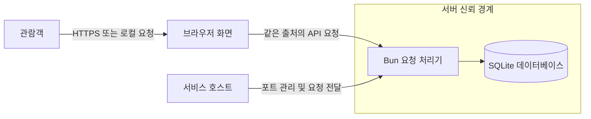
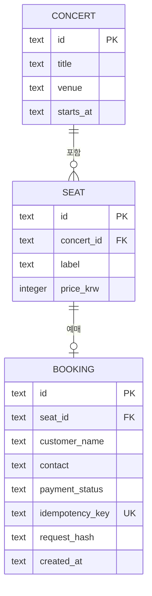
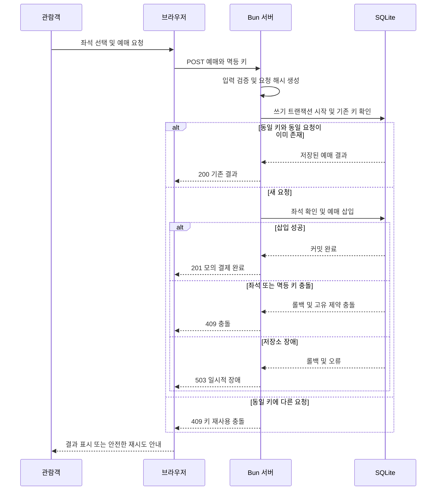

## context — 시스템 맥락
관람객은 브라우저에서 가상 공연과 좌석을 조회하고 이름과 연락처를 입력해 좌석 하나를 예매한다. 회원가입과 실제 결제는 초기 범위에서 제외하며 결제 결과는 모의 성공으로 기록한다. 브라우저와 서버 사이가 외부 입력 신뢰 경계이고, 서버와 SQLite 파일 사이가 영속 저장 경계다. 호스트가 서비스 포트를 소유하며 Bun 애플리케이션은 정적 화면, API 및 상태 확인을 제공한다.

## dataModel — 데이터 모델
공연은 여러 좌석을 가지며 각 좌석은 최대 하나의 확정 예매를 가진다. 공연과 좌석의 시드 식별자는 고정해 재시작 시 중복 없이 삽입한다. 예매에는 이름, 연락처, 모의 결제 상태와 요청 멱등 키를 저장한다. 외래 키를 활성화하고 좌석별 예매 고유 제약과 멱등 키 고유 제약을 적용한다. 멱등 키와 함께 정규화된 요청 해시를 저장해 다른 내용의 키 재사용을 감지한다.

좌석에는 공연별 좌석명에 대한 고유 제약을, 예매에는 seat_id 고유 제약을 둔다. 시간은 UTC ISO 8601 문자열로 저장하며 금액은 원 단위 정수다.

## api — API 계약
모든 API는 `/api` 아래에서 JSON을 사용한다. 공개 조회 및 예매에는 로그인이 필요 없으며 관리 API는 제공하지 않는다.
- `GET /api/concerts`: 공연 배열을 반환한다. 각 항목은 `id`, `title`, `venue`, `startsAt`을 포함한다.
- `GET /api/concerts/{id}`: 공연 정보와 `seats` 배열을 반환한다. 좌석 항목은 `id`, `label`, `priceKrw`, `available`을 포함한다. 조회 시점의 가용성은 예매 성공을 보장하지 않는다.
- `POST /api/bookings`: `Idempotency-Key` 헤더와 `{ "seatId": "...", "customerName": "...", "contact": "..." }`를 받는다. 성공 시 201과 `{ "id": "...", "seatId": "...", "paymentStatus": "mock_paid", "createdAt": "..." }`를 반환한다. 같은 키와 같은 요청의 재시도는 저장된 동일 결과를 200으로 반환한다.
- `GET /health`: 데이터베이스 접근 가능 시 200과 `{ "status": "ok" }`, 불가능 시 503을 반환한다.
- 오류 응답은 `{ "error": { "code": "...", "message": "..." } }`다. 잘못된 입력은 400, 없는 공연 또는 좌석은 404, 이미 예매된 좌석이나 다른 내용으로 재사용한 멱등 키는 409, 지원하지 않는 메서드는 405, 저장소 장애는 503이다. 내부 예외의 상세 내용은 반환하지 않는다.

## sequences — 요청과 실패 흐름
클라이언트는 예매 시 새 멱등 키를 생성하고 응답이 유실되면 같은 본문과 키로 재시도한다. 서버는 입력 검증 후 짧은 쓰기 트랜잭션에서 기존 키를 확인하고 좌석 존재 여부를 검증한 다음 예매와 모의 결제 상태를 함께 기록한다. 고유 제약 충돌은 롤백 후 409로 변환한다.

## deployment — 배포 구성
계획된 로컬 구성은 `frontend/index.html`의 정적 화면, `backend/main.ts`의 Bun 요청 처리기, 쓰기 가능한 영속 경로의 SQLite 파일이다. 의존성 설치 없이 측정된 `bun:sqlite`를 사용한다. 실행 계약은 `bun backend/main.ts`, 상태 경로는 `/health`이며 진입점은 `fetch(request)` 또는 `default {fetch}`를 내보내고 import 시 리스너를 시작하지 않는다. 포트는 호스트가 관리한다. 초기화 시 스키마를 준비하고 고정 식별자의 가상 공연과 좌석을 중복 없이 삽입한다. 측정 환경은 네트워크와 포트 바인딩이 불가능하므로 실제 배포나 외부 접속 검증은 이 단계에서 수행하지 않는다. HTTPS 종료와 영속 볼륨을 갖춘 단일 인스턴스 클라우드 배치는 미구현 제안이다.

## security — 보안
공개 API는 인증 없이 접근 가능하므로 예매 조회·변경·취소 API와 관리자 기능을 초기 범위에 포함하지 않는다. 이름과 연락처는 필수 길이 제한과 형식 검증을 적용하고, 좌석 ID와 멱등 키도 길이 및 형식을 제한한다. 요청 본문 크기를 제한하고 매개변수화된 SQL을 사용하며 화면 출력은 HTML로 해석하지 않는다. 연락처와 이름은 응답 및 로그에 재노출하지 않고 데이터베이스 파일은 서비스 계정만 접근하도록 보호한다. 배포 시 HTTPS, 호스트 측 요청 속도 제한 및 보존 기간 정책이 필요하다. 실제 결제 비밀값이나 외부 결제 연동은 없다. 브라우저와 API는 같은 출처로 제공한다.

## tradeOffs — 가정, 측정된 한계와 대안
SQLite의 단일 쓰기 트랜잭션과 고유 제약은 좌석 중복을 방지하지만 높은 동시 쓰기 부하에서는 경합할 수 있다. 단일 인스턴스 및 영속 파일을 전제로 하며 다중 인스턴스가 필요하면 공유 트랜잭션 데이터베이스로 이전하는 방안을 검토한다. 인증과 예매 확인용 조회 기능이 없으므로 응답을 잃은 사용자는 같은 멱등 키를 보유한 경우에만 결과를 복구할 수 있다. 모의 결제는 실제 결제나 환불을 의미하지 않는다. 측정 환경은 Bun 1.4.2, 설치된 패키지 없음, 네트워크 차단, 포트 바인딩 불가이며 처리량이나 실제 배포 가능성은 측정되지 않았다.

## operations — 운영
`/health`는 저장소 접근을 확인하며 호스트가 재시작 여부를 판단한다. 구조화 로그에는 요청 경로, 상태, 소요 시간 및 개인정보가 없는 오류 코드를 남기고 요청 본문과 연락처는 기록하지 않는다. 재시작 시 기존 데이터베이스를 유지하고 시드를 재실행해도 중복 공연과 좌석이 생기지 않도록 한다. 장애 복구 전 SQLite의 일관된 백업을 확보하고 복원 절차를 검증한다. 롤백은 이전 애플리케이션 버전으로 되돌리되 스키마 호환성을 먼저 확인하며, 호환되지 않는 변경은 정지 후 검증된 백업 복원으로 되돌린다. 복원 시 백업 이후 예매가 사라질 수 있으므로 별도 기록과 운영자 확인이 필요하다.

## references — 참조
- [예정된 API 계약](backend/api.md)
- [Bun 1.4.2 릴리스 참고 자료](https://bun.sh/blog/bun-v1.4.2)
